<p align="center">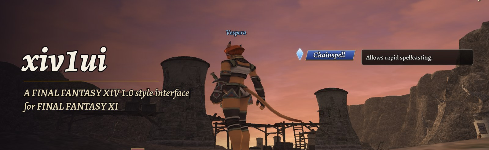</p>

An interface for **FINAL FANTASY XI** (Ashita v4) modelled on the **FINAL FANTASY XIV 1.0** HUD in its final form
(patches 1.18a–1.23b). It replaces the action bar, gauges, party list, target frame, chat logs, minimap, NPC
dialogue window and menus, and restyles the title screen and character creation. It only *displays* information and
acts through the game's own text commands when you click or press something. It never sends packets of its own.

Built and tested on **CatsEyeXI** and **HorizonXI**.

<p align="center">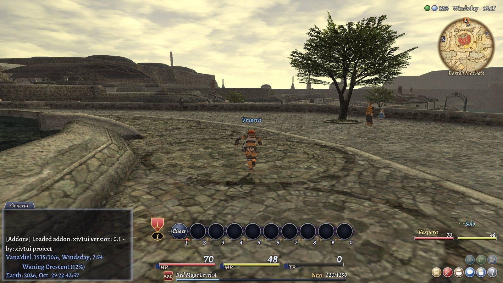</p>

## In the field

| | |
|---|---|
| 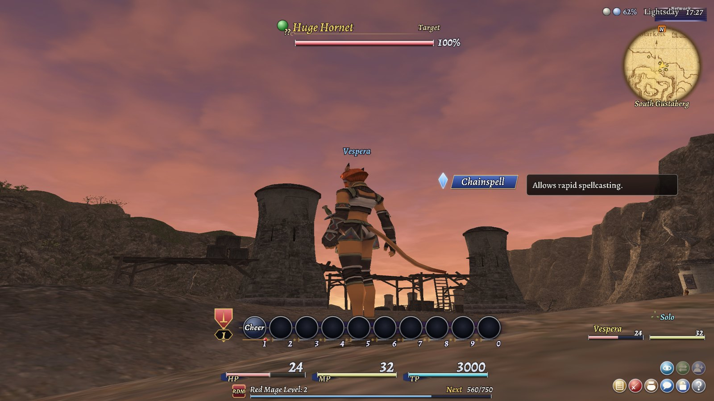 | 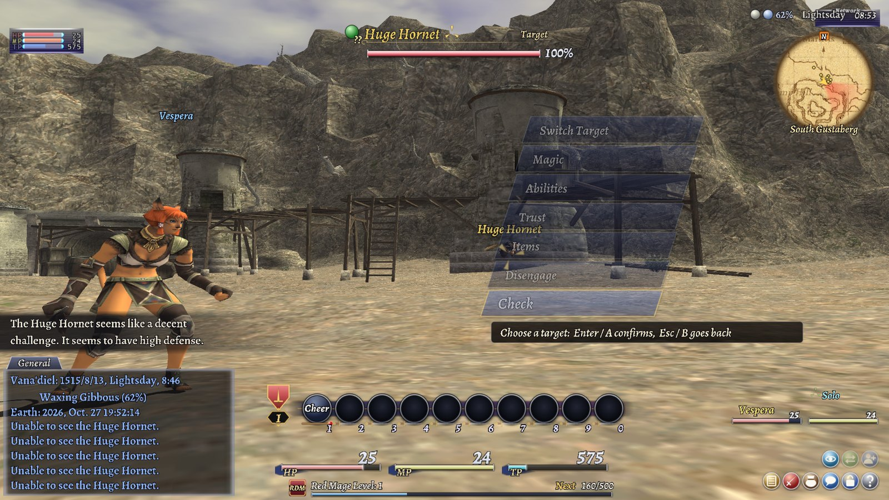 |
| **Combat.** Target frame with claim colour and HP, pop-up help on every action, HP / MP / TP gauges. | **Command menu.** FFXI's action menu, restyled; keys, mouse and controller all work as before. |
| 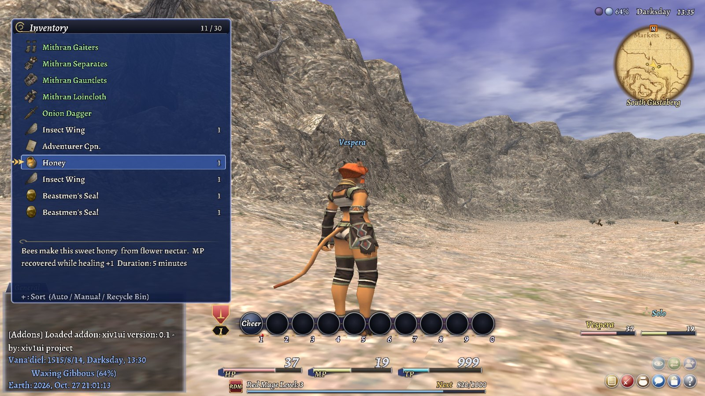 | 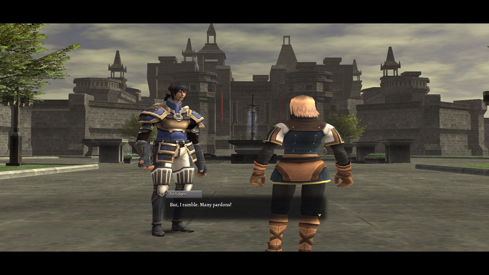 |
| **Inventory.** Item icons, counts and descriptions in 1.0's windows. | **NPC dialogue.** 1.0's talk window: the speaker's name plate and the line in a soft box. |

<p align="center">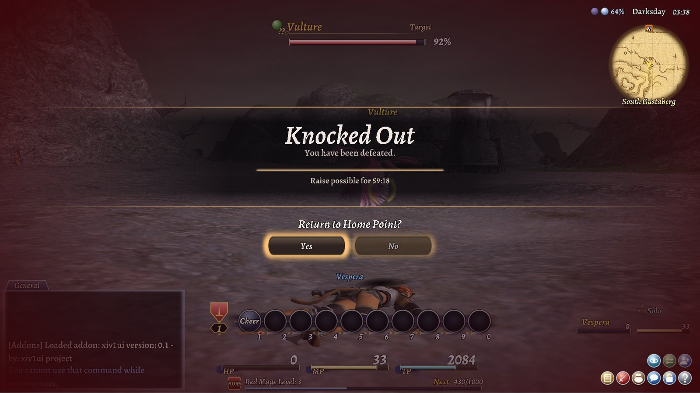</p>

## Before you log in

| | |
|---|---|
| 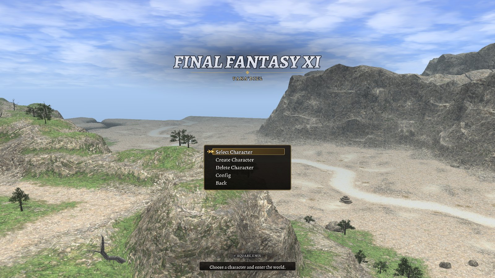 | 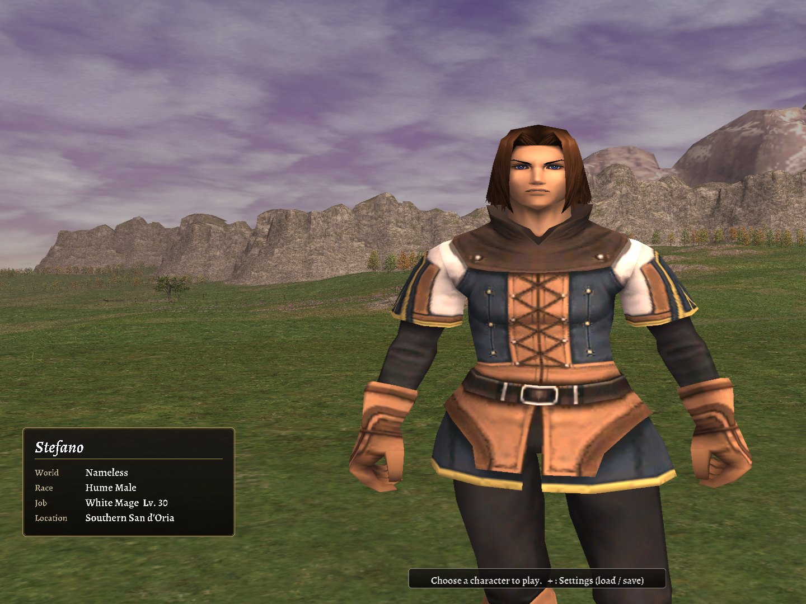 |
| **Title screen.** | **Character select.** Name, job, level and full location for each character. |
| 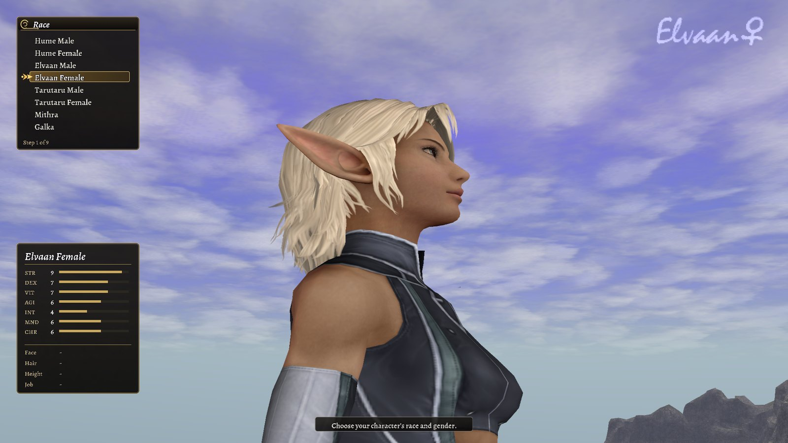 | 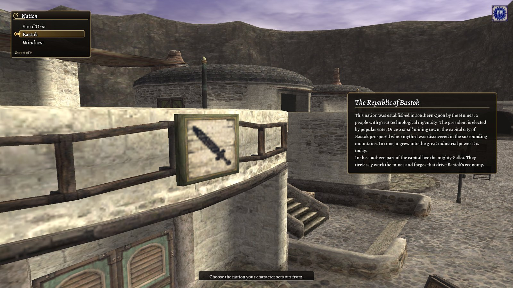 |
| **Creation.** Every step with a character sheet of starting stats and choices so far. | **Nation.** The game's own description of each nation. |

<p align="center">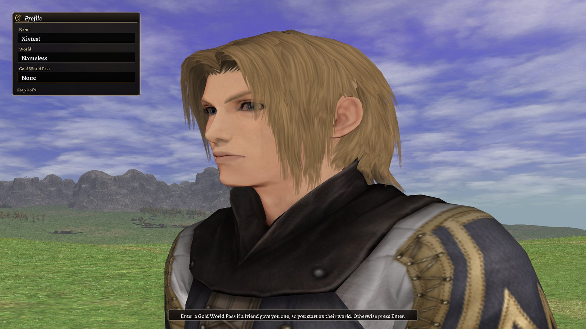<br><b>Name and world</b>, typed live into 1.0-style fields.</p>

## Install

See [`INSTALL.md`](INSTALL.md). In short, for any Ashita v4 install:

1. Copy `addons/xiv1ui` into your Ashita folder's `addons` folder.
2. Copy `scripts/xiv1ui.txt` into your Ashita folder's `scripts` folder.
3. Add this line at the end of `scripts/default.txt`:
   ```
   /include xiv1ui.txt
   ```
4. Start the game.

On macOS or Linux (CrossOver / Wine), `./install.sh "<Ashita folder>"` does steps 1–3. Turn off other HUD addons
that draw the same things (a minimap plugin, party list or action bar addons), or you'll see both. `INSTALL.md`
also has known fixes for running CatsEyeXI on Apple Silicon Macs.

## Using it

The addon's [README](addons/xiv1ui/README.md) lists every element, the commands, controller support and the
optional extras (the Nameplate plugin for name plates, HD area maps through XI-Pivot).

## Licence

GNU General Public License v3.0 or later (`LICENSE`). Fonts: Alegreya and Noto Serif JP (SIL Open Font License 1.1).
Text rendering: gdifonts (MIT). All artwork is original, drawn by `tools/make_art.py`; no Square Enix assets are
included. Screenshots show FINAL FANTASY XI. FINAL FANTASY is a registered trademark of Square Enix; this project
is not affiliated with Square Enix.
